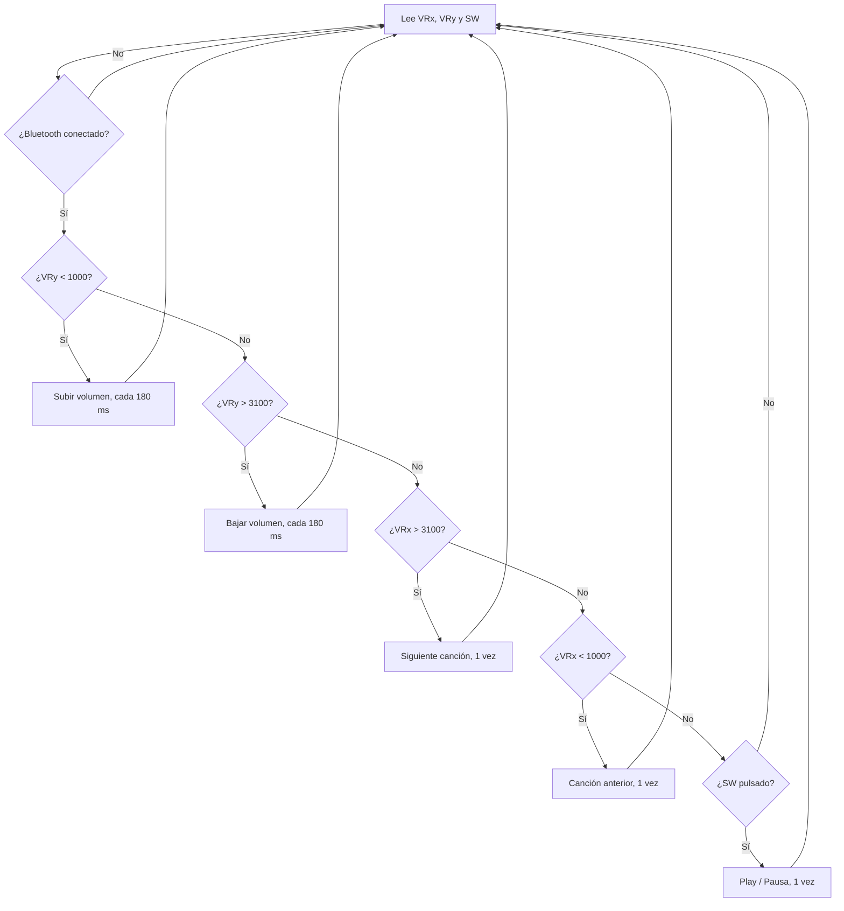

# 🎮🎵 TikTok · Teclado Bluetooth con un ESP32 + Joystick


> **Mini proyecto en donde el ESP32 se convierte en teclado Bluetooth, activado por un joystick.**
> Sube y baja el volumen de la computadora, cambia de canción y le da play / pausa — sin cables, sin instalar nada en la PC.

---

## ✨ ¿Qué hace?

Con un solo joystick controlas tu música en **Spotify, YouTube, Windows Media Player** y cualquier reproductor que responda a las teclas multimedia del sistema.

| Movimiento del joystick | Acción en la computadora |
| :--- | :--- |
| ⬆️ **Arriba** | 🔊 Subir volumen *(se repite mientras lo mantienes)* |
| ⬇️ **Abajo** | 🔉 Bajar volumen *(se repite mientras lo mantienes)* |
| ➡️ **Derecha** | ⏭️ Siguiente canción |
| ⬅️ **Izquierda** | ⏮️ Canción anterior |
| 👇 **Pulsar el joystick** | ⏯️ Play / Pausa |

El ESP32 se anuncia por Bluetooth como **`ESP32-WROOM-Media`** y la computadora lo ve como un teclado inalámbrico normal. No necesitas drivers, ni una app, ni un receptor USB.

---

## 🧰 Materiales

| Cant. | Componente |
| :---: | :--- |
| 1 | ESP32-WROOM-32 · **DevKit V1 de 30 pines** (DOIT) |
| 1 | Joystick analógico de 2 ejes + botón (módulo KY-023 o similar) |
| 5 | Cables Dupont hembra-hembra |
| 1 | Cable USB (Micro-USB o USB-C, según tu placa) para alimentar y programar |
| 1 | Computadora con Bluetooth (Windows 10 / 11, macOS, Linux o Android) |

> ⚡ **El joystick va a 3.3 V, NO a 5 V.** El ADC del ESP32 es de 3.3 V y con 5 V leerías valores fuera de rango.

---

## 🔌 Diagrama de conexión

### Tabla de conexiones

| Joystick | ESP32 DevKit V1 | GPIO | Función |
| :--- | :--- | :---: | :--- |
| `VCC` | `3V3` | — | Alimentación 3.3 V |
| `GND` | `GND` | — | Tierra común |
| `VRx` | `D32` | **GPIO 32** | Eje X · izquierda / derecha · ADC1 |
| `VRy` | `D33` | **GPIO 33** | Eje Y · arriba / abajo · ADC1 |
| `SW` | `D4` | **GPIO 4** | Botón · a GND al pulsar · pull-up interno |

### Esquema

```
                    ESP32-WROOM-32
                 DevKit V1 · 30 pines
                ┌─────────────────────┐
                │                     │
   JOYSTICK     │  3V3  ────────────► │ VCC
   ┌────────┐   │                     │
   │        │   │  GND  ────────────► │ GND
   │  VRx ──┼───┼──► D32 (GPIO 32)    │
   │  VRy ──┼───┼──► D33 (GPIO 33)    │
   │  SW  ──┼───┼──► D4  (GPIO 4)     │
   │  VCC ──┼───┘                     │
   │  GND ──┼───┐                     │
   └────────┘   │                     │
                └─────────────────────┘

        VCC = 3.3 V   ·   GND = común
        VRx / VRy = analógico 0-4095
        SW = digital, LOW al pulsar
```

### ¿Por qué GPIO 32 y 33?

Son **ADC1** (canales 4 y 5). El ADC2 deja de funcionar cuando el WiFi/Bluetooth está activo, así que con ADC1 el joystick sigue leyendo bien mientras el ESP32 está conectado por Bluetooth. GPIO 4 es un pin digital seguro para el botón, con `INPUT_PULLUP` interno, así no necesitas resistencia externa.

> 🔁 **Si te sale al revés:** es por la orientación del módulo del joystick. Solo intercambia las dos líneas de ese eje en el código, no muevas los cables.

---

## 🧠 ¿Cómo funciona el ESP32 como teclado Bluetooth?

Este es el corazón del proyecto. No es magia, son 3 ideas juntas:

### 1. El ESP32 se hace pasar por un teclado HID

La computadora no ve un "ESP32", ve un **dispositivo HID (Human Interface Device)** por Bluetooth Low Energy (BLE), igual que un teclado inalámbrico de tienda.

```
ESP32 ──(BLE, perfil HID)──► PC / celular
        "Soy un teclado"
              │
              ▼
   La PC acepta teclas multimedia
   como si vinieran de un teclado real
```

El perfil HID incluye un tipo especial de teclas llamadas **teclas de consumidor / multimedia**, que no escriben letras, sino que controlan el sistema:

- `MEDIA_VOLUME_UP` / `MEDIA_VOLUME_DOWN`
- `MEDIA_NEXT_TRACK` / `MEDIA_PREV_TRACK`
- `MEDIA_PLAY_PAUSE`

Por eso funciona en Spotify o YouTube aunque la ventana no esté al frente: son teclas del sistema operativo, no atajos de una app.

### 2. El joystick se lee como un voltaje

El joystick es en realidad dos potenciómetros (uno por eje) + un botón.

- En el centro, cada eje lee **~2048** (la mitad de 0-4095, ADC de 12 bits).
- Al empujar arriba, `VRy` baja hacia 0. Al empujar abajo, sube hacia 4095.
- Al empujar a un lado, `VRx` hace lo mismo en el otro eje.
- Al pulsar, `SW` pasa de HIGH a **LOW** (GND).

El código usa una **zona muerta** para que no se dispare solo:

```
0 ──────── 1000 ──────── 3100 ──────── 4095
  ▲ Zona      │  Centro, no      │  ▲ Zona
  activa      │  hace nada       │  activa
```


---

## ⚠️ PRIMERO: instala estas 2 librerías (en este orden)

> **Este es el paso que hace que funcione.** Sin estas librerías, el proyecto no compila.

### 1️⃣ NimBLE-Arduino

1. En Arduino IDE: **Sketch > Incluir librería > Administrar bibliotecas...**
2. Busca: `NimBLE-Arduino`
3. Autor: **h2zero**
4. Versión: **2.3.8 o mayor**
5. Dale a **Instalar**.

### 2️⃣ HijelHID_BLEKeyboard

1. En la misma ventana de **Administrar bibliotecas...**
2. Busca: `HijelHID_BLEKeyboard`
3. Autor: **hijelhub**
4. Dale a **Instalar**.

---

## 💻 Instalación y carga del código

### Requisitos

- **Arduino IDE 2.x**
- **Core ESP32 3.3.12** instalado *(Herramientas > Placa > Gestor de tarjetas > busca `esp32` de Espressif)*
- Las 2 librerías de arriba, en ese orden


### Pasos

1. Clona o descarga este repositorio.
2. Abre `control_multimedia_joystick_wroom32/control_multimedia_joystick_wroom32.ino` en Arduino IDE.
3. Conecta el ESP32 por USB y selecciona su puerto.
4. Dale a **Subir** (flecha →).
5. Abre el Monitor Serie a **115200 baudios**. Debe decir:

```
Control multimedia BLE listo. Busca 'ESP32-WROOM-Media' en Bluetooth.
```

---

## 📲 Emparejar con la computadora

### Windows 11

1. Presiona **Win + I** para abrir Configuración.
2. Ve a **Bluetooth y dispositivos** y prende el Bluetooth.
3. Dale a **Agregar dispositivo > Bluetooth**.
4. Espera y elige **`ESP32-WROOM-Media`**.
5. Dale a **Conectar**. No pide PIN.

### Windows 10

Configuración > Dispositivos > Bluetooth y otros dispositivos > Agregar Bluetooth u otro dispositivo > Bluetooth > `ESP32-WROOM-Media`.

### Android / macOS / Linux

Ajustes / Preferencias > Bluetooth > buscar dispositivos > `ESP32-WROOM-Media` > Emparejar.

> 💡 El ESP32 solo acepta **una conexión BLE a la vez**. Si no aparece en la PC, revisa que no siga conectado a tu celular. Presiona el botón **RST / EN** del ESP32 para que vuelva a anunciarse.

---

## 💾 Código

El código completo está en [`control_multimedia_joystick_wroom32/control_multimedia_joystick_wroom32.ino`](control_multimedia_joystick_wroom32/control_multimedia_joystick_wroom32.ino).

```cpp
#include <HijelHID_BLEKeyboard.h>

HijelHID_BLEKeyboard keyboard("ESP32-WROOM-Media", "Crucito", 100);

const uint8_t PIN_VRX = 32;  // eje X: izquierda / derecha
const uint8_t PIN_VRY = 33;  // eje Y: arriba / abajo
const uint8_t PIN_SW  = 4;   // pulsar joystick

const int UMBRAL_BAJO = 1000;
const int UMBRAL_ALTO = 3100;
const unsigned long REPETIR_VOLUMEN_MS = 180;
unsigned long ultimoVolumen = 0;
bool enZonaX = false;
bool swPresionadoAntes = false;

void setup() {
  Serial.begin(115200);
  pinMode(PIN_SW, INPUT_PULLUP);
  analogReadResolution(12); // 0-4095
  keyboard.begin();
  Serial.println("Control multimedia BLE listo. Busca 'ESP32-WROOM-Media' en Bluetooth.");
}

void loop() {
  if (!keyboard.isConnected()) { delay(200); return; }

  int x = analogRead(PIN_VRX);
  int y = analogRead(PIN_VRY);
  bool sw = (digitalRead(PIN_SW) == LOW);
  unsigned long ahora = millis();

  // Volumen: eje Y, se repite mientras se mantiene
  if (y < UMBRAL_BAJO) {
    if (ahora - ultimoVolumen >= REPETIR_VOLUMEN_MS) {
      keyboard.tap(MEDIA_VOLUME_UP);
      ultimoVolumen = ahora;
    }
  } else if (y > UMBRAL_ALTO) {
    if (ahora - ultimoVolumen >= REPETIR_VOLUMEN_MS) {
      keyboard.tap(MEDIA_VOLUME_DOWN);
      ultimoVolumen = ahora;
    }
  }

  // Siguiente / anterior: eje X, solo 1 vez por empujón
  if (x > UMBRAL_ALTO && !enZonaX) {
    keyboard.tap(MEDIA_NEXT_TRACK);
    enZonaX = true;
  } else if (x < UMBRAL_BAJO && !enZonaX) {
    keyboard.tap(MEDIA_PREV_TRACK);
    enZonaX = true;
  } else if (x >= UMBRAL_BAJO && x <= UMBRAL_ALTO) {
    enZonaX = false;
  }

  // Play / Pausa: solo al presionar
  if (sw && !swPresionadoAntes) {
    keyboard.tap(MEDIA_PLAY_PAUSE);
    delay(50);
  }
  swPresionadoAntes = sw;

  delay(20);
}
```

---

## 🛠️ Solución de problemas

| Problema | Causa probable | Solución |
| :--- | :--- | :--- |
| `BleKeyboard.h: No such file or directory` | Falta la librería | Instala **NimBLE-Arduino** y **HijelHID_BLEKeyboard** (ver arriba) |
| `cannot convert 'std::string' to 'String'` en `BleKeyboard.cpp` | Librería T-vK vieja con core 3.3.12 | **No uses T-vK.** Usa el código de este repo, con `HijelHID_BLEKeyboard.h` |
| No aparece `ESP32-WROOM-Media` en Bluetooth | Ya está conectado a otro dispositivo, o no se subió el código | Desconéctalo del celular, presiona RST en el ESP32 y busca de nuevo |
| El volumen sube solo / se dispara solo | Centro del joystick no está en 2048 | Revisa la zona muerta (1000-3100) o calibra tu joystick en el Monitor Serie |
| Arriba baja el volumen (al revés) | Orientación del módulo | Intercambia las líneas de `MEDIA_VOLUME_UP` y `MEDIA_VOLUME_DOWN` en el código |
| No compila `HijelHID_BLEKeyboard.h` | Falta NimBLE o versión vieja | Instala **primero** NimBLE-Arduino **2.3.8 o mayor**, luego HijelHID |

---

---

## 👤 Autor

**Ivan Cruz** — [@ingiavanbeto](https://github.com/ingiavanbeto)

Proyecto hecho para TikTok / YouTube: electrónica práctica con ESP32, sin cables y con código que sí compila en el core actual.

Si te sirvió, dale ⭐ al repo y compártelo.

---

### 📄 Licencia

MIT — úsalo, modifícalo y compártelo libremente, solo conserva el crédito al autor.
